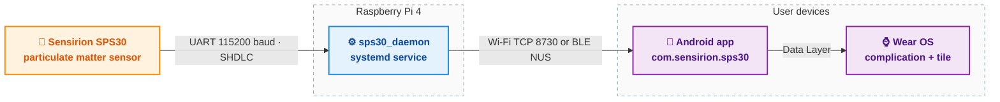

# SPS30 air-quality monitor on Raspberry Pi

An end-to-end personal air-quality monitoring system built around the **Sensirion SPS30** particulate matter sensor and a **Raspberry Pi 4** controller, with a companion **Android** phone and tablet app and a **Wear OS** complication plus tile.
Verified against real hardware (SPS30 firmware 2.1, Raspberry Pi 4).

> **Status: finished and frozen.**
> This repository is a sealed reference build of the Pi variant, archived at `pi-app-v0.1.0-frozen` (2026-08-01) and no longer under active development.
> Later iterations ship on the ESP32 and ESP32-S3 variants with the same product name - see the companion repositories under `mlfisch3`.

## System architecture



- The SPS30 streams particle readings over its UART interface at 115200 baud.
- A Python daemon on the Pi (`pi/sps30_daemon.py`) runs as a systemd service, parses the SHDLC frames, and exposes readings on the local network and over Bluetooth Low Energy.
- The Android app discovers the Pi daemon, pulls the archive, draws the plot, and relays current readings to a paired Wear OS device.

## Hardware

The SPS30 has a 5-pin JST ZH connector.
It supports both UART and I2C; this build uses UART, selected by leaving the `SEL` pin floating.
UART was chosen because the Raspberry Pi's Broadcom I2C controller has a known clock-stretching bug and the SPS30 stretches the clock.

### SPS30 pinout

| Pin | Name | UART function |
|----:|------|---------------|
| 1 | VDD | +5 V supply |
| 2 | RX  | Serial data into the sensor (host TX) |
| 3 | TX  | Serial data out of the sensor (host RX) |
| 4 | SEL | Interface select; floating = UART |
| 5 | GND | Ground |

### Wiring to the Raspberry Pi 40-pin header

| SPS30 pin | Pi header pin | Pi function |
|---|---|---|
| 1 VDD | pin 2 | +5 V |
| 2 RX  | pin 8 | GPIO 14 / TXD |
| 3 TX  | pin 10 | GPIO 15 / RXD |
| 4 SEL | floating | |
| 5 GND | pin 6 | Ground |

The daemon opens `/dev/serial0` by default; the exact device alias depends on the Pi model's UART configuration.

## Software components

| Component | Path | What it does |
|---|---|---|
| Driver and CLI | `pi/sps30.py` | SHDLC-level driver with a stand-alone command-line interface. Only runtime dependency is `pyserial`. |
| Daemon | `pi/sps30_daemon.py`, `pi/sps30-daemon.service` | Long-running systemd service that owns the sensor, serves the record over the local network and over BLE. |
| BLE transport | `pi/sps30_ble.py` | Bluetooth Low Energy transport using the Nordic UART Service. |
| GUI client | `pi/sps30_gui.py` | Standalone PyQt viewer for the daemon's record, used during development. |
| Chart module | `pi/chartview.py` | Shared time-series history model with decimation and bisect windowing. |
| Wire format | `pi/wire.py` | Canonical message encoding shared by the daemon and the client. |
| Android app | `app/` | Android Studio Gradle project, Compose UI, phone module plus Wear OS module. applicationId `com.sensirion.sps30`. |
| Design docs | `docs/` | PRD, architecture, BLE transport design, feature design notes. |
| Tests | `tests/` | Python unit tests exercising the driver, daemon, wire format, and client. |

## Repository layout

Four directories at the top keep the README visible on the GitHub landing page:

```
app/     Android Studio Gradle project (phone + Wear OS)
docs/    Design documents and Android reference material
pi/      Python driver, daemon, GUI, BLE transport, systemd unit
tests/   Python unit tests and the run_tests.sh entrypoint
```

## Quickstart

### Pi daemon

```bash
sudo apt install python3-serial
sudo cp pi/sps30-daemon.service /etc/systemd/system/
sudo systemctl enable --now sps30-daemon
```

### Driver CLI

```bash
python3 pi/sps30.py --device /dev/serial0 --once
```

### Android app

Open `app/` in Android Studio, build the debug variant, install on the phone.
The app auto-discovers the Pi daemon on the local network.

### Tests

```bash
cd tests && ./run_tests.sh
```

## Lineage

This Pi build is the first in a lineage of three hardware iterations under the same product line:

1. **SPS30 on Raspberry Pi 4** - this repository, frozen 2026-08-02.
2. SPS30 on ESP32-WROOM-32E - the pioneer microcontroller port.
3. SPS30 on Olimex ESP32-S3 - the second microcontroller iteration.
4. SEN66 on Olimex ESP32-S3 - the current product, with gas and humidity channels added.

Later iterations use the same Android app lineage with distinct `applicationId` values so builds coexist on one device.

## License

License to be added.
