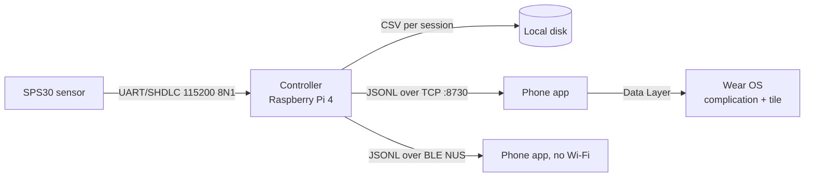

# PRD: SPS30 air-quality monitor (Pi controller + Android app)

Version 1.0, 2026-07-31.
Describes the **Pi build**, which is the reference implementation: branch
`acquisition-profiles`, app applicationId `com.sensirion.sps30`.

## What this document is

This is a product requirements document written to be sufficient on its own.
A development team starting from an empty repository, with the hardware on a
bench and no access to the existing source, should be able to build an equivalent
system of equivalent quality from what is written here.

That is a higher bar than a feature list, so this document carries three kinds of
content and keeps them visibly separate:

- **Requirements** (`C-n` controller, `P-n` protocol, `A-n` app, `W-n` watch,
  `N-n` non-functional). What the system must do. Numbered so they can be cited.
- **Rationale.** Why a requirement is the way it is. Included wherever a
  reasonable team would otherwise "simplify" it back into a bug we already found
  and fixed.
- **Field notes.** Things that cost hours to learn on real hardware and cannot be
  deduced from a datasheet.

Where a number appears (a timeout, a threshold, a current draw) it is a measured
or specified value, not a guess, and its source is named.

---

## 1. The product

A **particulate-matter monitor for a home or small workplace**.

A Sensirion SPS30 optical sensor runs continuously somewhere in a building.
A small always-on controller beside it owns the sensor, records every reading to
disk, and serves that data over the local network.
People look at it from their phones: current levels, a plot of the recent past,
and a notification when the air gets bad.

**Who it is for.** Someone who wants to know what they are breathing and to be
able to act on it: is the kitchen extractor working, did the wildfire smoke get
inside, is the workshop dust settling before I take the mask off.
The reader is assumed to be capable and interested but not a scientist.

**The job it does.** Two things, in this order of importance:

1. Tell me what the air is like **right now**, at a glance, and let me trust that
   the number is live.
2. Let me see **how it changed**, over minutes or days, precisely enough to link a
   change to a cause.

Everything else in this document exists to serve those two, or to keep the thing
running unattended for months without being tended.

### 1.1 Product principles

These are the standards that produce "equivalent quality". A team that meets
every numbered requirement below but violates these principles will have built
something measurably worse.

- **The instrument must always look alive.** A reading that has not visibly moved
  in twenty seconds reads as broken even when it is correct. See `A-12`.
- **Never show a number the user cannot act on, and never hide one they can.**
  Precision belongs where precision is wanted (the crosshair), not everywhere.
- **The axis is part of the measurement.** An unreadable or absent axis makes the
  plot decorative. See `A-20` through `A-24`.
- **Legibility is a safety feature, not a preference.** This may be consulted in
  a hurry, by someone stressed, without reading glasses. Type is sized from the
  height it needs on glass, and the plot gives up area to pay for it.
- **Anything that touches the sensor is guarded.** A mis-tap must not silently
  stop a recording that has been running for a week. See `A-30`.
- **Recording outranks display.** The controller records whether or not anyone is
  watching, and no client action may risk the record. See `C-2`.
- **Degrade, do not die.** A corrupt frame, a dropped read, a vanished client, a
  sensor asleep: each has a defined recovery that keeps the session alive.

---

## 2. System shape



Three tiers, and the split matters:

- The **sensor** speaks a checksummed binary framing and nothing else.
- The **controller** is the only thing that ever opens the serial port. It owns
  acquisition and storage. It is the store of record.
- **Clients** are pure subscribers. They may request state changes, but they
  never hold data the controller does not have.
- The **watch** is a client of the phone, not of the controller.

Rationale: a phone leaving the building, running out of battery, or being force
stopped must have no effect on the recording. This one boundary is why the
system survives ordinary domestic use.

---

## 3. Hardware requirements

### H-1 Sensor
Sensirion **SPS30**, connected over **UART**, 115200 baud, 8N1, no flow control.

### H-2 Interface selection
The SPS30's `SEL` pin selects the interface and is **latched at power-up**.

| SEL | Interface |
|---|---|
| **floating (unconnected)** | **UART** |
| tied to GND | I2C |

Leave `SEL` unconnected. Changing it requires a full power cycle, not a reset.

### H-3 Wiring
Cross TX and RX exactly once.

| SPS30 pin | Signal | Connects to |
|---|---|---|
| 1 | VDD | **5 V** (not 3V3) |
| 2 | RX | controller **TX** |
| 3 | TX | controller **RX** |
| 4 | SEL | leave unconnected |
| 5 | GND | GND |

Both UART pins are specified "TTL 5V and LVTTL 3.3V compatible", so a 3.3 V host
needs **no level shifter**. Only VDD needs 5 V.

### H-4 Do not use I2C on a Broadcom host
The Raspberry Pi's I2C controller has a clock-stretching defect and the SPS30
stretches the clock. UART with per-frame checksums sidesteps it entirely. On a
Pi, `/dev/serial0` (the mini-UART) is sufficient; there is no need to disable
Bluetooth or move to the PL011.

### H-5 Power budget
The fan draws **55 mA typical, 80 mA peak at 5 V**, in bursts as it spins up.
Supply and cable must be good for **at least 1 A** with margin for the host.
A 100 uF electrolytic across the sensor's 5 V and GND, close to the sensor, is
cheap insurance against fan inrush.

> **Field note, and the single most expensive lesson in this project.**
> A Pi 3 on a weak supply sat at 4.75 V and the sensor never booted its comms:
> **dead silence, not garbled bytes.** Days were spent suspecting the protocol.
> The rule that falls out of it, worth printing on the wall:
> **dead silence means interface, wiring or power. Garbled bytes mean baud rate
> or logic levels.**
> Check the host's own undervoltage telemetry before debugging any code.

---

## 4. Controller requirements

The controller is a long-lived process that owns the serial port, the recording,
and the network listener.

### 4.1 Measurement values

**C-1.** Each reading is exactly **ten values in this fixed order**:

```
pm1_0, pm2_5, pm4_0, pm10, nc0_5, nc1_0, nc2_5, nc4_0, nc10, typical_size
```

Mass concentrations are ug/m3, number concentrations #/cm3, typical size um.

This order is a **hard contract**. It is reused by the CSV, the wire protocol,
the client's columnar store and the on-device binary format. Do not reorder it,
and do not "improve" it by sorting or grouping.

**Precision that is actually real** (SPS30 datasheet v2.0 s1.1):

| Quantity | Precision, 0-100 range |
|---|---|
| PM1.0, PM2.5 mass | +-(5 ug/m3 + 5% of measured value) |
| PM4.0, PM10 mass | +-25 ug/m3 |
| NC0.5, NC1.0, NC2.5 | +-100 #/cm3 |
| NC4.0, NC10 | +-250 #/cm3 |

Typical indoor readings here are 1-3 ug/m3, so the whole value sits inside the
stated uncertainty.
**Absolute accuracy is not the whole story**, and this distinction drives several
UI requirements: the sensor resolves *change* far better than it agrees with
truth. Measured over 120,000 consecutive real readings, consecutive samples move
by a median of 0.019 ug/m3 (p95 0.057) on the mass fields.
So changes of hundredths are meaningful signal; the absolute value is not.

### 4.2 Acquisition

**C-2.** Acquisition runs independently of clients.
Zero connected clients must change nothing about recording.

**C-3.** The controller has an explicit state, broadcast on every change:

| State | Meaning |
|---|---|
| `checking` | no sensor detected; polling for one |
| `measuring` | streaming readings and writing the CSV |
| `paused` | sensor present, measurement stopped by the user |
| `cleaning` | fan self-clean in progress |
| `sleeping` | duty cycle: sensor asleep between measurements |
| `warmup` | duty cycle: fan spun up, readings not yet trusted |
| `shutting_down` | host powering off; safe to unplug shortly |

**C-4. Acquisition profile.** A profile is settable at runtime and is:

```
{mode, interval, cycle_s, warmup_s, average_s}
```

- `mode`: `continuous` or `duty_cycle`.
- Default: continuous at `interval = 1.0` s.
- Duty cycle defaults: `cycle_s = 900` (15 min), `warmup_s = 30`, `average_s = 30`.
- `warmup_s` has a floor of **8 s** and must never be settable below it.

Runtime settability is a requirement, not a convenience: a startup-only interval
forces a restart, and a restart ends the recording session.

**C-5. Continuous mode** records one reading every `interval` seconds with the
fan and laser continuously on.

A longer continuous interval saves **data, not power**.
The UI must say so (`A-33`), because the opposite assumption is nearly universal.

**C-6. Duty-cycle (low power) mode** follows Sensirion's published sequence
(*Low-Power Operation of the SPS30*, app note v1, Aug 2020, Figure 5):

```
wake; start measurement
wait warmup_s          (fan spin-up and statistics accumulation)
read for average_s     (one reading per second)
record the average as ONE point
stop measurement; sleep
sleep until cycle_s has elapsed from wake
```

At 60 s of measurement per 15 min this gives **~3.5 mA average against ~55 mA
continuous**, a factor of 15.
Measured on this implementation: **3.702 mA**, against the published 3.5.

**C-7. Sleep and wake.** Sleep (`0x10`) and Wake (`0x11`) require firmware >= 2.0.
The controller must read the firmware version and refuse duty-cycle mode with a
clear message on older units.

**Waking requires a bare `0xFF` byte on the line before the Wake frame, within
100 ms**, because sleep disables the sensor's UART receiver and the pulse is what
wakes it. Retry the sequence (3 attempts) before concluding the sensor is absent.

**C-8. A sleeping sensor must be detectable.**
Because Sleep disables the UART, a plain probe reads silence and concludes "no
sensor", permanently, and the device appears bricked.
Sensor detection must therefore attempt the wake sequence before giving up.

> Field note: this was a real device-bricking bug. It was fixed and then verified
> against a genuinely stuck unit, which came back with
> `"sensor was asleep; woken during detection"`.

**C-9. Profile changes must not strand the state machine.**
A profile change mid-cycle (while sleeping, warming up, or averaging) must abandon
the in-flight cycle cleanly and enter the new profile.
Implement with a **generation counter**: a cycle checks its generation after every
sleep and abandons itself if the profile has moved on.

**C-10. Starting an already-measuring sensor is an error.**
The sensor answers `0x43` ("command not allowed in current state").
Always issue Stop Measurement before Start when the prior state is unknown.

### 4.3 Settling and data quality

**C-11.** Readings taken while the measurement is disturbed are **flagged, not
discarded**, via a non-blank `event` column: `startup`, `resume`, `restart`,
`clean`.
Clients exclude them from plots by default but may show them.

Flag the first **20 s** of each new measuring session and after each clean.

**C-12.** In duty-cycle mode, **never flag**.
Rationale, and this was a real bug: the settle window is counted in *rows*, and
duty cycling produces one row per cycle, so a 20-row settle window hid the first
20 cycles, which at a 15 min period is **five hours of invisible data**.

### 4.4 Storage

**C-13.** Readings are appended to a **CSV per session**, columns:

```
index, timestamp, <the ten fields in C-1 order>, event
```

`index` is zero-padded to 7 digits. `timestamp` is ISO 8601 with offset, in the
controller's local zone.

**C-14.** Flush every row; **fsync every 30 rows**.
A hard power loss then costs at most ~30 readings.
The real exposure on a Pi is SD card and filesystem corruption, not this file,
which is why `C-25` exists.

**C-15.** A new session file opens on start, resume and restart.
Filenames must not collide: if the derived name exists, disambiguate rather than
appending to an unrelated session.

**C-16.** Recovery after a transient read failure **continues the same session
file** rather than opening a new one.

> Field note: this requirement comes from a user-visible mystery. History
> appeared to be capped at about a day, with the oldest visible point silently
> becoming "today" each morning. The cause was a single read timeout ending the
> session and opening a new CSV, while the client backfilled only the *current*
> file. Nothing was lost on disk; it was invisible. Tolerate
> **5 consecutive read failures** before declaring the sensor lost.

**C-17. Fan auto-clean accounting.**
The sensor's internal auto-clean counter **resets whenever the sensor is powered
off or slept** (datasheet s4.2). Under duty cycling the sensor is asleep ~93% of
the time, so its own weekly auto-clean will effectively never fire.

The controller must therefore accumulate **measurement seconds itself**, persist
that across restarts, and trigger a manual fan clean at least weekly
(604800 s of accrued measurement). Allow ~12 s for the clean to complete.

This is silent, slow sensor degradation if missed, which is the worst kind.

### 4.5 Host telemetry and shutdown

**C-18.** Broadcast host power state on change and include it in the greeting:

```
{source: "mains"|"battery", charging: bool, percent: float|null,
 voltage_v: float|null, runtime_hours: float|null, method: "modelled"|"gauge"}
```

A mains-powered Pi reports `source: "mains"` with nulls, **plus its undervoltage
and throttling state**, which on this hardware is genuinely load-bearing
diagnostic information (see H-5).
Poll host power at most every 60 s.

**C-19. Runtime estimate without a current sensor.**
Modelling beats measuring here, because the controller knows exactly how long the
sensor ran. Energy per cycle is
`(55 mA * t_measure + 0.038 mA * t_sleep) / 3600` mAh plus a controller term.
Measure the controller term **once per firmware build on the bench** and bake it
in; do not try to measure it at runtime.
Report `method` so the UI can honestly say "estimated".

For a battery product, fit a fuel-gauge IC (MAX17048 or MAX17260) and delete the
guesswork. Note the Broadcom I2C defect of `H-4` is host-specific and does not
apply to other controllers.

**C-20. Safe shutdown.** A command must park the sensor (sleep), close and fsync
the CSV, broadcast `shutting_down`, and power the host off.
Provide a physical button path as well, so it works with no phone present.

### 4.6 Multiple clients

**C-21.** Multiple clients stream concurrently. Cap at **8**.

**C-22. Per-client outbound queues are bounded** (1000 messages) and messages are
classed:

- **Lossy** (readings, state): drop oldest under pressure. A slow phone must not
  stall acquisition or other clients.
- **Lossless** (file content, archive chunks): must block rather than drop.

> Field note: a bare "drop if full" on archive chunks silently corrupts the
> archive the user believes they have. Backpressure with a bounded wait, and fail
> loudly if it expires.

**C-23. Control arbitration.** Any client may view. **Mutating** commands (pause,
resume, clean, restart, raw, set profile, shutdown) require holding a control
claim.

- Claim has a TTL of **120 s**, refreshed on each command.
- Expiry is essential: a phone that walks out of range must not lock everyone out.
- Broadcast holder changes so other clients can show "controlled by <name>".
- Clients announce a human-readable name and the roster is broadcast.

**C-24. Command routing must be exhaustively tested.**
Add a test asserting that **every** defined command constant is actually routed
by the dispatcher.

> Field note: a newly added command was defined, documented, handled in the state
> machine, and unreachable, because the dispatcher had its own separate allowlist.

### 4.7 Archive transfer

**C-25.** The controller can stream **every recorded session as one archive** to a
client, chunked (256 KB) and base64-framed, with a metadata message first
(name, bytes, sessions, rows).

Rationale: the controller may not persist. On the Pi this is a 32 GB card and an
easy feature; the requirement exists because the *phone* should be able to become
the store of record.
Verified end to end at 245 sessions / 864,896 readings, with the resulting archive
passing an integrity check.

Compression belongs on the **transfer** path, where radio time dominates, and not
in on-device storage.

---

## 5. Protocol requirements

**P-1. Transport-agnostic newline-delimited JSON (JSONL).**
One JSON object per line. The identical byte stream runs over:

- **TCP**, default port **8730**, controller binds `0.0.0.0`.
- **BLE**, via a Nordic UART Service (NUS) write + notify characteristic pair.

Rationale: choosing JSONL over a binary protocol costs bandwidth that is not
scarce on a LAN and buys the ability to add a transport without touching a single
message definition. The BLE transport was added later and required no protocol
change at all.

**P-2. Use BLE, not Classic Bluetooth.**
The intended production controller (ESP32 class) has BLE but **no BR/EDR**.
A Classic RFCOMM transport would have to be thrown away.

**P-3. Messages** (controller to client):

| Message | Payload |
|---|---|
| `hello` | product, serial, firmware, state, current csv, index |
| `reading` | csv, index, timestamp, the ten fields, event |
| `state` | state, detail |
| `profile` | the active acquisition profile |
| `power` | see `C-18` |
| `control` | holder, holder_name, expires_in |
| `clients` | roster and max |
| `file_list` | name, rows, bytes, start per session |
| `file_data` | name, columns, rows chunk, done |
| `backup_meta` / `backup_chunk` | archive transfer, see `C-25` |
| `raw_response` | request and response, hex |
| `error` | message |

**P-4. Commands** (client to controller):
`pause`, `resume`, `clean`, `restart`, `raw`, `list_files`, `get_file`,
`set_profile`, `shutdown`, `identify`, `claim`, `release`, `backup`.

`get_file` accepts `since_index` so a reconnecting client backfills only what it
is missing. Chunk file replies (500 rows) so a large session does not monopolise
the link.

**P-5. Decoding is forgiving.** A malformed or short frame yields nothing and the
stream continues. A streaming loop must be able to skip a corrupt reading rather
than die.

**P-6. Discovery.** The client finds the controller by sweeping private /24
subnets derived from **every local interface**, not from the socket's own address.

> Field note: Android returns a wildcard from `DatagramSocket.getLocalAddress()`,
> so deriving the subnet from it finds nothing. Enumerating interfaces also makes
> discovery work with a VPN active, which is otherwise a common failure.

**P-7. A VPN cannot be worked around.**
An app subject to a full-tunnel VPN **cannot** bind around it: binding to the
Wi-Fi network fails with `EPERM` even with the network obtained via
`requestNetwork` and `CHANGE_NETWORK_STATE` granted.
This is Android enforcing its own guarantee and only the VPN itself may permit
bypass.
Do not spend time on it. Detect the condition and **say so** ("a VPN may be
blocking local network access; try Bluetooth").

Binding to the Wi-Fi network is still worth implementing for a different case: an
access point with **no internet**, where Android keeps cellular as the default
route and unbound sockets go out over mobile data to an address that only exists
on the Wi-Fi. Use the network's own `SocketFactory`; do not call `bindSocket` on
a freshly constructed socket, which has no file descriptor yet and fails
silently.

---

## 6. Phone app requirements

### 6.1 Connection

**A-1.** Three connection modes, presented as three buttons: **Wi-Fi**,
**Bluetooth**, **Disconnect**.

- The current mode renders greyed **with an accent ring** plus "Connected".
- A genuinely unavailable radio renders greyed **without** a ring, plus a reason
  ("Bluetooth off").

The distinction matters: "you are already here" and "you cannot go here" must not
look the same.

**A-2. Disconnect is a client-side action only.**
It closes the transport and stops the foreground service. The banner must say
plainly that **the sensor is still recording**.

**A-3.** On reconnect, backfill the gap via `get_file` with `since_index`, and
merge without duplicating.
De-duplicate on `(csv, index)`, which survives out-of-order and overlapping
backfill.

**A-4. Wi-Fi gives many viewers; Bluetooth gives one.**
Say so in the UI rather than failing mysteriously when a second phone tries.

### 6.2 Live readouts

**A-10.** The main screen shows large readouts for **PM1.0** and **PM2.5**.
These are the two numbers the product exists to show, and they get the space to
prove it.

**A-11.** Each readout is **also a toggle** controlling whether that series is on
the plot, with a clear active border. The tiles double as the plot's legend, so
no separate legend is drawn.

**A-12. Readouts show two decimals.**
This is deliberately finer than the sensor's absolute accuracy and is **not** a
precision claim. It is a liveness requirement (principle 1): consecutive samples
move by about 0.02 ug/m3, so one decimal holds the same value for long stretches
while the plot's newest point visibly moves, and users reasonably conclude the
display is frozen or lagging.

**A-13.** Typography inside a readout: the number is the tallest element, units
sit beside it rather than below, everything is bold, and margins are uniform on
all four sides. Use tabular figures so the number does not jitter as digits
change.

**A-14.** A connection and state banner, including a countdown through each phase
of the duty cycle when in low-power mode, so a user can see it working rather
than wonder.

**A-15.** A power pill showing mains or battery, charge state, and the
controller's undervoltage warning when present.

### 6.3 The plot

**A-20. Windows.** Preset time windows (default 1m, 5m, 30m, 1h) plus
user-editable presets, and a whole-session view.

**A-21. Pin.** One control, engaged or not.
Not engaged, the view follows now. Engaged, the left edge is fixed and the right
edge grows with now.
Long press sets and snaps to a reference pin. Repeated taps cycle recent pin
origins.

**A-22. Averaging.** Selectable plot interval (raw, 5 s, 10 s, 30 s, 60 s, 1 h)
plus user-editable choices, and an **Auto** control that picks an interval from
the visible span.

Auto must choose **from the buttons the user can see**, and light that button up.
An auto-chosen intermediate value that matches no button leaves the user unable
to tell what averaging is in force, which defeats the feature.

**A-23. Both the Pin control and the raw/Auto controls are pinned in place** and
do not scroll away when the preset rows overflow, with a visual cue that the rows
scroll.
A control that scrolls off screen reads as a control that vanished.

**A-24. Axes.**

- Y labels prefer **whole numbers**, but must never force them.
  A range between two integers (1.2 to 1.8, exactly where indoor air sits) has no
  integer in it, and forcing integers draws **no gridlines and no labels at all**.
  Below a span of 1, use the natural round step (0.5, 0.2, 0.1) and label it with
  exactly the decimals that step requires.
  Compute the step **once** and use it for both range snapping and labelling;
  deriving it twice lets the two disagree when snapping crosses a span of 1.
- Y gridlines are labelled, with unlabelled half-step minor lines between.
- X ticks sit at the **centres of equal bands**, not at the range's ends.
  End ticks put half a label outside the plot, and shifting those two inward to
  compensate is what makes them collide with their neighbours.
- Every x label centres on its tick, with **no special case for the ends**.
- How many x labels fit is **measured from rendered text width**, not assumed from
  a tick count, because label width changes with the format ("14:05" versus
  "14:05:32"), the font scale and the locale. Thin them evenly when they do not
  fit; keep the gridlines.
- The x caption names the time zone, resolved from a real instant so it follows
  DST. Dates appear under a tick only where the day changes.
- The y caption is rotated counter-clockwise, as in a research paper, and centred.
- Axis type is sized from the **cap height wanted on glass**, not the font size.
  A digit's cap height is about 71% of its font size, and sizing by font size is
  how a first attempt at "make it bigger" produces no visible change.

**A-25. Log y axis** as an option, floored just under the smallest resolvable
value, since a true zero is indistinguishable from "cleaner than the sensor can
resolve" and has no position on a log axis.

**A-26. Alert threshold line** drawn **only when the threshold falls inside the
plotted y range.**
Clamping an out-of-range threshold to the top of the axis makes a reading of 13
look as though it is nearly touching an alert set at 20, which is a false reading
of the data and worse than not drawing it.

**A-27. Inspection crosshair.**
One finger inspects; two fingers pan and zoom. The crosshair persists after the
finger lifts and is dismissed by a touch outside the plot.
Single-finger inspection is required because in a 15 min duty cycle, reading the
actual timestamps off the plot is the only way to confirm it is working.

**A-28. The crosshair anchors to whatever the view is holding still.**

- **Pinned**: it holds its **instant** and travels left with its own data, staying
  on the event the user put it on.
- **Live**: it holds its **place on the plot** and the data flows underneath, so
  parking it at the right edge gives a running readout of each new sample as it
  lands, in the manner of `less +F` following a file still being written.
- Switching between the two must re-anchor **without moving the cursor**.

**A-29. Performance budget.** See `N-1`. The plot's responsiveness must not
depend on how much history exists.

### 6.4 Safety, options, alerts

**A-30. Everything that affects the sensor sits behind a safety guard.**
Pause, resume, clean, restart, shutdown, and **switching acquisition mode**, since
that stops and starts the sensor.
The guard re-engages automatically (20 s) and any interaction with the menu resets
its timer.

**A-31. Alerts** are phone-side and never sent to the controller.
Escalating thresholds (defaults 20, 55, 150 ug/m3), each able to notify and to
highlight the plot.
Require **10% hysteresis** and a **5 minute cooldown**, or a reading sitting on a
threshold produces a stream of notifications.

**A-32. Naming discipline: "export" means two different things and must not.**
Use explicit labels:

- **"Save as CSV"** writes out what is currently on the plot.
- **"Copy all sessions to this device"** fetches the controller's whole archive.

Confusing them risks someone believing they hold a backup when they hold a
screenshot's worth of numbers. Archives land in the device's Downloads directory
and the app reports where.

**A-33.** The options sheet must state plainly that a longer **continuous**
interval saves data and not power, and prompt towards duty cycling above 60 s.

**A-34. Background monitoring** runs as a foreground service, on by default.

> Field note, and a nasty one: a foreground service must call `startForeground()`
> **before** doing any work, or Android kills the process with
> `ForegroundServiceDidNotStartInTimeException` five seconds later. With default-on
> monitoring this produced a crash loop on every launch, and `am start` reported
> `Status: ok` throughout. Only the crash buffer revealed it. Promote first, then
> work, and catch the refusal.

### 6.5 Client-side data model

**A-40. Columnar storage.** Hold history as parallel primitive arrays (epochs,
one per field) plus a flags array, not as a list of objects with a map per point.

**A-41. Decimate during extraction.**
Never materialise the full visible range and then reduce it. Walk the source with
a stride and emit at most the target number of points.
Never compute more points than the canvas has pixels.

> Field note: the original code materialised the entire window with a hashmap
> lookup per point per field, which at 48 h and 1 Hz is roughly 700,000 hash
> lookups and several MB of allocation, and the gesture loop ran it on **every
> pointer event** at ~120 Hz. The visible symptom was lag plus "momentum" after
> the finger lifted, which was the queued pointer backlog draining.

**A-42.** Coalesce gesture updates to one recompute per frame, and suspend the
live tick while a gesture is in progress.

**A-43.** Retain 48 h client-side by default, trimmed in O(1) via a head offset.

---

## 7. Watch requirements

**W-1.** A **complication** showing current PM2.5 and a **tile** showing PM2.5
with a sparkline.

**W-2.** The phone relays to the watch on a **minimum interval, default 3
minutes**, user-selectable (1, 3, 5, 15 min).

**W-3. Cap the sparkline at about 60 points** before publishing.
A ~100 px sparkline cannot show 3600 points, and the full series was the bulk of
a ~14 KB payload written three times a minute.

**W-4.** Suppress no-op publishes: skip the write when the value has not moved
meaningfully (0.5 ug/m3).
Quantise any timestamp in the payload to ~60 s buckets, or it changes on every
publish and defeats the Data Layer's free de-duplication of identical items.

**W-5.** Publish the sparkline on its **own** item path, so the complication,
which does not use it, is not woken by sparkline-only changes.

**W-6.** Drive the relay from the acquisition cadence: a 15 min duty cycle does
not need a 3 min relay.

> Rationale for the whole section: the observed drain was not the complication's
> refresh period at all. It was radio wakeups from over-frequent writes carrying
> a payload two orders of magnitude larger than the display could use.

**W-7.** Battery and power detail stay on the phone and are not relayed.

---

## 8. Non-functional requirements

**N-1. Chart interaction stays responsive independent of history size.**
Guard it with a test that builds a full retention window of points (172,800 at
1 Hz) and asserts the recompute stays inside a fixed budget.

**N-2. Memory is bounded everywhere data accumulates**: client queues, client-side
history retention, and per-message chunking.

**N-3. Unattended operation.** The controller must survive sensor dropouts, client
churn and its own restart without losing the recording or needing attention.

**N-4. Legibility.** Axis and readout type sized from cap height on glass; the
plot yields area to pay for it (see principle 3 and `A-24`).

**N-5. Honest reporting.** Anything estimated says it is estimated (`C-19`).
Anything the system cannot do is stated plainly rather than attempted and failed
silently (`P-7`).

**N-6. No framework dependency in the controller.**
Standard library plus a serial library. It must stay trivially deployable and
importable by every layer above it.

---

## 9. Decisions a new team should not quietly reverse

Each of these looks like an easy simplification and is not.

1. **UART, not I2C** (`H-4`). Broadcom clock-stretching defect.
2. **BLE, not Classic Bluetooth** (`P-2`). The production controller has no BR/EDR.
3. **JSONL over a binary wire format** (`P-1`). Bought a whole transport for free.
4. **The controller is the store of record** (`C-2`). The clean boundary that
   makes phone behaviour irrelevant to data integrity.
5. **Decode returns nothing on a bad frame instead of raising** (`P-5`). Lets a
   streaming loop skip a corrupt reading rather than die.
6. **Flag disturbed readings, do not drop them** (`C-11`). The user can choose;
   dropped data cannot be recovered.
7. **Duty cycling never flags** (`C-12`). Row-counted settle windows and one row
   per cycle interact catastrophically.
8. **Control claims expire** (`C-23`). Without a TTL, one phone leaving the
   building locks out the household.
9. **Two decimals on the readouts** (`A-12`). It is a liveness requirement, not a
   precision claim, and "correcting" it to one decimal reintroduces a display that
   looks broken.
10. **Whole-number y labels are a preference, not a rule** (`A-24`). Forcing them
    blanks the axis on exactly the data this product usually shows.
11. **Do not fight the VPN** (`P-7`). It is not possible, and it was measured.

---

## 10. Verification

**V-1. Controller test suite**, run on every change.
Current reference implementation: **252 tests passing** (plus 6 skipped where an
optional TUI dependency is absent, 3 hardware-only deselected).
Cover at minimum: SHDLC framing vectors, the duty-cycle state machine against a
fake serial device **that models device state** (so an illegal Start is caught),
the wake `0xFF` sequence and its retries, the weekly clean accumulator, control
arbitration with several fake clients, and `C-24`'s command routing assertion.

**V-2. App unit tests.**
Current reference implementation: **121 tests passing**.
Cover the wire mirror, discovery, reconnection and backfill de-duplication, the
relay policy, the alert engine with hysteresis and cooldown, chart windowing and
decimation, and the axis rules in `A-24`.

Configure the JVM test runner to return default values for unmocked platform
calls, or a stray log call inside a retry loop hangs the suite with no failing
test to point at. This cost a full debugging session.

**V-3. Hardware verification.** Confirm the duty cycle by watching the fan stop
between cycles, and confirm timings from the recorded timestamps rather than from
logs alone.

**V-4. On-device UI verification.**
Do not trust "looks fine". Geometry claims (label overlap, alignment, spacing)
should be **measured**: dump the frame, threshold it, and extract text bounding
boxes, centres and gaps.
That is how the axis requirements in `A-24` were confirmed, to the pixel, after an
eyeball check had already passed.

Note that a locked phone screenshots as pure black, which is easily mistaken for a
rendering failure.

**V-5. Battery verification** for watch changes: run overnight and compare against
a pre-change baseline. Nothing shorter is meaningful.

---

## 11. Out of scope for this document

Deliberately excluded, with the reason:

- **Authentication.** The controller is unauthenticated on the LAN. Acceptable for
  a bench instrument, **not** acceptable for a shipped product, and it is
  naturally solved alongside device provisioning rather than bolted on.
- **Provisioning and onboarding.** Belongs with the production controller, over
  BLE, which also sidesteps the IP stack and therefore the VPN problem entirely.
- **On-controller storage limits.** The Pi has ample disk. A constrained
  controller needs a different storage design, documented separately.
- **Restoring an archive back onto the controller.** The inverse of an export that
  is newer than the control model, and it grants a client more authority than
  anything in the protocol does today.
- **An in-app information page about particulate matter.** Wanted, and a content
  project rather than a code one: what these particles are, what produces them,
  what harm they do and by what mechanism, properly cited.

---

## 12. Glossary

| Term | Meaning |
|---|---|
| **SHDLC** | Sensirion's framing over the serial line: `0x7E` delimiters, `0x7D` escape byte, byte stuffing, LSB-complement checksum |
| **PM1.0 / PM2.5 / PM4.0 / PM10** | Mass concentration of particles below that diameter in um, ug/m3 |
| **NC0.5 ... NC10** | Number concentration below that diameter, #/cm3 |
| **Typical particle size** | The distribution's typical diameter, um |
| **Session** | One continuous recording, one CSV file |
| **Flagged reading** | A reading taken while the measurement was disturbed; recorded but excluded from plots by default |
| **Duty cycle / low power** | Wake, warm up, average, sleep; one recorded point per cycle |
| **Control claim** | The expiring right to issue mutating commands |
| **Settle window** | The period after a disturbance during which readings are flagged |
